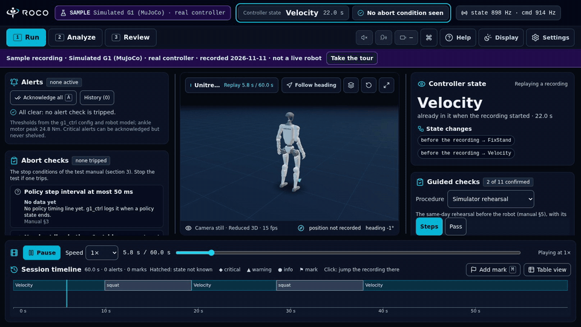
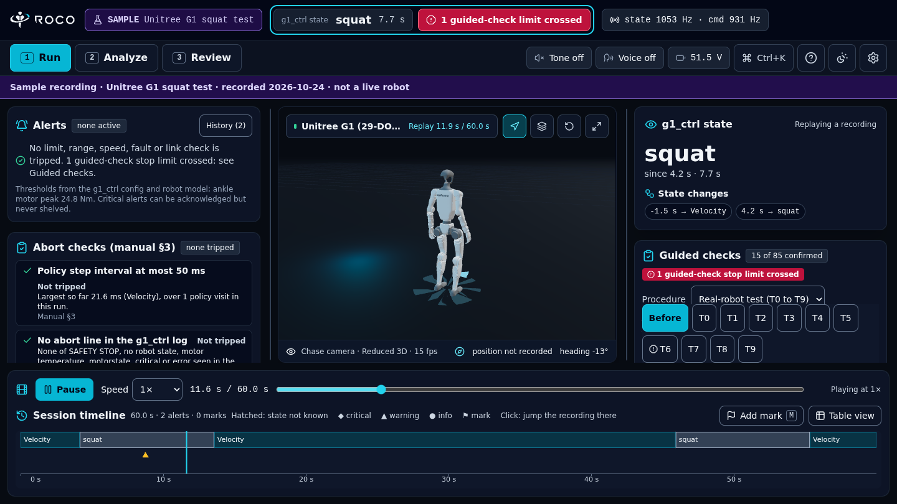
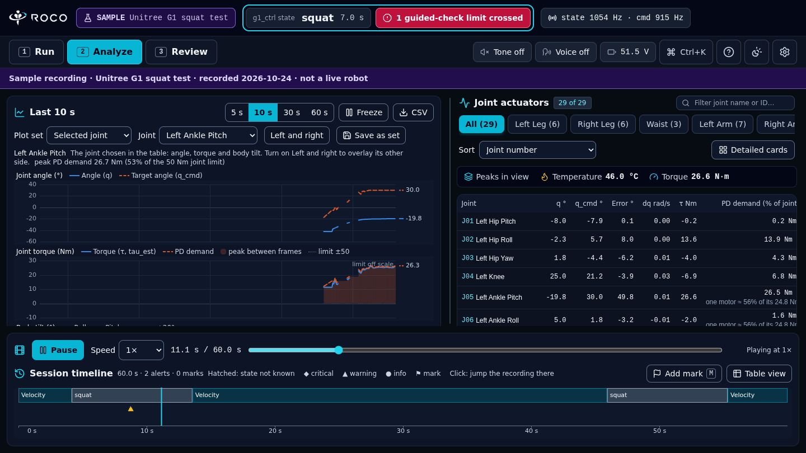
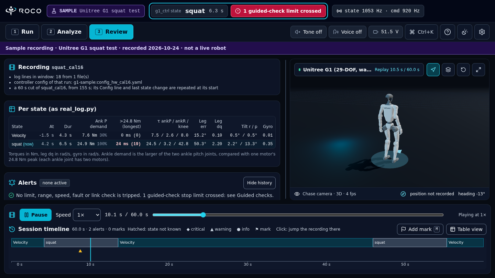

<h1>
  <picture>
    <source media="(prefers-color-scheme: dark)" srcset="docs/brand/roco-logo-dark.svg">
    
  </picture>
</h1>

[](https://github.com/orvane-sys/ROCO/actions/workflows/ci.yml)
[](LICENSE)

[](https://orvane-sys.github.io/ROCO/)

A read-only monitor for a Unitree G1 (29-DoF) running Unitree's `g1_ctrl` deploy controller from
[unitree_rl_mjlab](https://github.com/unitreerobotics/unitree_rl_mjlab), in the MuJoCo simulator or on the robot. It shows
what the robot is doing in your browser, warns when a limit from the controller's own config is approached, and replays
recordings. It never commands anything. Its limits come from your controller config; the guided checks and a few of ROCO's own
limits were written for a 29-DoF EDU with the waist roll and pitch locked (type 6).

**Who it is for:** people who run `g1_ctrl` on a G1, or rehearse in MuJoCo first, and want a second screen that shows the
joints, the controller state and the limits while they watch the robot.

React 19, Vite, Tailwind v4 and three.js in the browser; a Python bridge reads DDS. ROS 2 support is planned; ROCO v0.1.1
monitors Unitree G1 over DDS.

**Not a safety system. No warranty.** ROCO only watches. It cannot see the rope, the spotter or the room, and "no alert"
never means "safe". Keep your E-stop in reach and follow your own test procedure.

ROCO is an independent project, not affiliated with or endorsed by Unitree Robotics. Unitree and G1 are named only to say which
robot it works with.

**Supported:** Ubuntu 22.04 with Python 3.10. Tested in Chrome. Node 20 or newer is needed only to build the page from a clone.

## Try it without a robot

Open the [live demo](https://orvane-sys.github.io/ROCO/). It plays 60 s of a simulated G1 (MuJoCo) driven by the real g1_ctrl
controller as it stands and squats twice, labelled SAMPLE everywhere, in your browser: no robot, no install, no account, and no
data leaves the page. Press Play, drag the timeline, open Analyze and Review. It works on a phone too.



| Run: what to watch during a test | Analyze: plots and the joint table | Review: numbers per state and the recording |
|---|---|---|
|  |  |  |

The images are the page replaying the sample, drawn in software (no GPU), so the 3D view is the reduced one.

## Quick start

Install the wheel first (see [Install](#install)). Then pick one:

**1. No robot, no internet.** The same sample as the live demo, served from your PC:

```bash
roco demo                  # prints http://localhost:8780/?demo=1; open it
```

**2. The simulator.** Start Unitree's `unitree_mujoco` with the G1 scene on the loopback interface, as the unitree_rl_mjlab
README describes. Then start `g1_ctrl` with its output copied into the log file ROCO reads (see
[Controller state](#controller-state)), in `~/unitree_rl_mjlab/deploy/robots/g1/build`:

```bash
mkdir -p ../log && stdbuf -oL ./g1_ctrl --network=lo 2>&1 | tee ../log/log.txt
```

In a third terminal:

```bash
roco sim                   # prints a link; open it
```

**3. The robot.** On the PC wired to the G1, with the interface that reaches it:

```bash
roco robot enp2s0          # prints a link; open it
```

**4. A recording.** A folder or zip in the [recording format](docs/recording-format.md):

```bash
roco replay <folder-or-zip>
```

Each command starts the bridge, serves the page on this PC only (port 8780) and prints the link to open. Ctrl-C, closing the
terminal or `kill` stops it. `--port` and `--web-port` change the ports. The hosted demo page cannot show your own robot: open
the link `roco` prints.

## Install

The quickest install is the wheel on the [latest release](https://github.com/orvane-sys/ROCO/releases/latest): it has the
built page inside, so the PC needs Python only, no Node. It gives the commands `roco` and `roco-dds-bridge`.

Do not run `pip install roco`. That name on PyPI belongs to an unrelated package, so it installs something else. ROCO is
installed from the links here.

```bash
pipx install https://github.com/orvane-sys/ROCO/releases/download/v0.1.1/roco-0.1.1-py3-none-any.whl
roco demo                             # the sample; needs nothing more
roco replay <folder-or-zip>           # a recording; needs nothing more

# live data (sim or robot) also needs DDS, in the same environment
pipx inject roco cyclonedds==0.10.2
pipx runpip roco install -e <your clone of unitree_sdk2_python>
```

Install `unitree_sdk2py` from a clone, the way Unitree describes it (`git clone`, then `pip install -e .`). A plain
`pip install git+https://…` build leaves out `unitree_sdk2py/b2`, which has no `__init__.py`, and the import then fails.

An install from the source (`pipx install git+https://github.com/orvane-sys/ROCO`) has the commands but no page, because the
page is built by Node and is not in git. Use the wheel, or a clone.

From a clone, build the page once with `npm ci && npm run build`, then use `./scripts/roco` the same way
(`./scripts/roco sim`, `./scripts/roco robot enp2s0`, `./scripts/roco replay <folder-or-zip>`, `./scripts/roco demo`).
The page needs no internet at run time (no external fonts, scripts or models).

## Controller state

ROCO shows the controller state (Passive, FixStand, Velocity and the rest of your config) and the keys for the next one, read
from `g1_ctrl`'s log. Unitree's `g1_ctrl` prints its state changes ("FSM: Change state from Passive to FixStand") to its
terminal only, so copy that output into the file ROCO reads: run it as in the Quick start,

```bash
mkdir -p ../log && stdbuf -oL ./g1_ctrl --network=lo 2>&1 | tee ../log/log.txt
```

from `deploy/robots/g1/build`. Keys typed into that terminal still reach `g1_ctrl`. A build of `g1_ctrl` with a `--log` option
writes the same file itself. For a log somewhere else, pass `--ctrl-log FILE` to `roco sim` or `roco robot`.

Without a log the page says the controller state is unknown, and everything else still works. If `g1_ctrl` runs on another PC
(the robot's own), its log is not on this one, so the state stays unknown.

## Deploy folder

The bridge reads `g1_ctrl`'s config (the joint limits, gains and state names), the robot model and the log from the deploy
folder, read only. It looks, in order, at:

1. `--deploy-dir DIR`, or the `ROCO_DEPLOY_DIR` variable;
2. `~/unitree_rl_mjlab/deploy_lock`, if it exists;
3. `~/unitree_rl_mjlab/deploy`, the folder Unitree's repository ships.

It prints the folder it uses when it starts. On robot data it reads `robots/g1/config/config_hw.yaml` when there is one, else
`config.yaml`. Without the folder it warns and starts with ROCO's own default limits.

## Watching from another PC

The bridge and the page listen on this PC only (loopback). To watch from a laptop, prefer an SSH tunnel and leave them there:

```bash
ssh -L 8765:127.0.0.1:8765 -L 8780:127.0.0.1:8780 testpc     # on the laptop, then open the link roco printed
```

`--host 0.0.0.0 --token SECRET` on the bridge also works, but the page sends the token in the address over plain `ws://`, so
anyone on that network can read it. Use it only on the robot's own wired network. See [SECURITY.md](SECURITY.md).

## Troubleshooting

| What you see | What to do |
|---|---|
| "Not connected" | The bridge is not running, or the page points at another port. Start `roco sim`, `roco robot IFACE` or `roco replay`, and open the link it prints. |
| The hosted demo page does not show my robot | It cannot: it only plays the sample. Open the link `roco` prints on your PC. |
| Connected, but no robot data | Wrong interface: the simulator is on `lo`, the robot on the wired interface that reaches it (`ip -br addr`). `g1_ctrl`, the simulator and ROCO use DDS domain 0; for another, run `roco-dds-bridge --domain N`. A firewall must let UDP multicast through on that interface. |
| Controller state unknown | `g1_ctrl` prints its state to its terminal only. Run it through `tee` as in [Controller state](#controller-state). |
| A warning that the deploy folder was not found and ROCO's default limits are used | Pass `--deploy-dir` with your `unitree_rl_mjlab/deploy` folder, or see [Deploy folder](#deploy-folder). |
| "port 8765 (bridge) is already in use" | Another `roco` or bridge is running. Stop it, or use `--port` / `--web-port`. |
| An import error from `unitree_sdk2py` (often about `b2`) | Install it from a clone with `pip install -e .`, as in [Install](#install). |
| "the page is not built" (from a clone) | Run `npm ci && npm run build` once. |

## What it shows

- A 3D model driven by `rt/lowstate`.
- The `g1_ctrl` state read from its log (see [Controller state](#controller-state)), with the keys for the next state.
- Alerts for ankle PD demand, torque and joint-range limits, temperature, motor state, tilt, and stream gaps. The first
  alert of a burst is pinned on top, alerts after a change into Passive say so, each one has a "Do:" line with its manual
  section, and warnings can be shelved for the session (critical alerts cannot). The responses and the state-aware severity
  rules are data in `src/config/alertPolicy.ts`.
- The manual §3 abort criteria as named checks: step interval, abort lines in the `g1_ctrl` log, and torso lean in the squat.
  "Not tripped" never means "safe": the bar says "No abort condition seen".
- Optional alert sound and spoken alerts (off by default, switches in the header) and screen reader announcements for new
  critical alerts.
- Guided checks for the test stages T0 to T9 and the sim rehearsal (`src/config/procedures/g1_type6.ts`, plain data, so
  another robot can add its own). They are written from `TEST_MANUAL.md`, the author's own G1 test manual, which is not
  published, so the checks and their § numbers are an example and not a test plan for your robot. Write your own. Each
  item says which section it comes from and is one of: measured by ROCO,
  a log line that must appear, or ticked by a person. A stage moves on only when you say so. A crossed stop limit cannot
  be hidden or marked "not applicable", and "Within limit" never means "safe to continue". Reference values are labelled
  sim or robot and a sim value is not shown as the robot's. The bridge sends a hash of `TEST_MANUAL.md` (read only); if it
  differs from the one the procedure was written for, the card says so. Ticks on live data are kept in the browser for the
  rest of the day; ticks made on a replay are never kept.
- One session timeline under every workspace: the `g1_ctrl` state as a band, alerts as ticks (diamond critical, triangle
  warning, circle info) and your marks. Click it in a replay to jump there; on live data it freezes the plots at that moment
  (Resume on the timeline or in Analyze). `M` adds a mark with an optional note (live marks are kept in the browser for the
  rest of the day, replay marks are not). The table view lists the same events for keyboard and screen reader use, with
  arrow keys, Shift for ten times as far, Enter and Escape on the band. For a replay the band shows the whole recording
  from the first moment (the bridge sends every state change); an older bridge shows it only as far as it was played.
- Plots in Analyze: windows of 5, 10, 30 and 60 s, a plot set (Selected joint, Ankles, Knees, Balance, Squat check, or one
  you saved) and a Left and right switch. At most four lines share an axis and a unit; torque, angle and tilt get their own
  plots, never a second y-axis. Hovering a plot moves one cursor across all plots, the timeline, the joint table (angle,
  target, torque and PD demand at that time) and, in a replay, the 3D pose. **CSV** saves the visible window, with the
  unix time first, and PlotJuggler opens it directly. Names are plain first ("Angle (q)"); the Help sheet has a glossary.
- A per-state table (the same numbers as `real_log.py`), and all 29 motors.
- A **session report** in Review, as Markdown laid out like the hardware test reports (summary, setup, timeline, per-state
  numbers, guided checks, abort checks, alerts, marks). It lists what ROCO saw and says it is not a clearance.
- Replay of recordings from a folder or a zip, in the [recording format](docs/recording-format.md) that `g1_record` writes.
- A short first-run tour of the Run workspace, skippable, shown once per browser and restartable from Help.
- Every action has a button on screen. **Help** (`?`) lists each one and where it is; the command palette (Ctrl+K) finds
  them by name and says where each lives.

Values were checked against `g1_record` CSVs from live simulator runs (differences below 5e-6).

## Accessibility

The page is built to WCAG 2.2 AA: every control works from the keyboard, state is never shown by colour alone (alerts have
their own shapes), live alerts are announced once and rate limited, and the layout holds at 320 px wide and at 400 % zoom.
`npm run check:a11y` runs axe and a keyboard walk in CI. A listening pass with a screen reader is described in
[docs/screen-reader-test.md](docs/screen-reader-test.md); it is done by a person, not by CI.

## Safety

- The bridge subscribes only. A guard stops any DDS writer from being created in the process, so it cannot command the
  robot and does not trip `g1_ctrl`'s other-publisher check. Frames from the page are ignored except replay controls.
- The bridge listens on loopback only. Another host needs `--host` with `--token`.
- ROCO does not show a "safe to start". It cannot see the rope, the spotter or the room. Abort in `g1_ctrl` with `LT+B` on
  the remote (Unitree's default), or `p` in its terminal if your build has the keyboard abort.
- Values from the simulator are not expectations for the real robot, and ROCO does not show one as the other.

## Development

Run the page with `npm install && npm run dev` (http://localhost:5173) and the bridge with
`python3 scripts/roco_dds_bridge.py --iface lo` (or `--iface enp2s0 --source robot`, or `--replay <folder-or-zip>`). The
checks, the regression tests and the performance tools are in [CONTRIBUTING.md](CONTRIBUTING.md); CI runs them on every push.

## Layout

- `docs/` the recording format, the screen reader test script and the operator test sheets. `scripts/check-*.mjs` the page's
  own checks.
- `src/` the page. `src/services/telemetryStream.ts` is the WebSocket client; `src/types/monitor.ts` the bridge frames.
- `scripts/roco` the launcher. `scripts/roco_dds_bridge.py` the read-only DDS bridge. `scripts/roco_common.py` the wire format,
  robot profiles and WebSocket server both bridges share.
- `tools/sim-drive/` an older MuJoCo simulator bridge that accepts drive commands. It is not part of the monitor; see its README.

## Licence

ROCO is licensed under Apache-2.0 (see `LICENSE`). The robot model files in `public/models/g1_description/` are from
Unitree's [unitree_ros](https://github.com/unitreerobotics/unitree_ros), BSD-3-Clause, © 2016-2022 Unitree Robotics;
see the `LICENSE` file in that folder. The built page carries `LICENSE` and `THIRD-PARTY-LICENSES.md`, the notices of the
packages bundled into it; `npm run build` writes both and fails if a notice is missing.

The ROCO name and logo are not covered by the Apache-2.0 licence; see [`docs/brand/`](docs/brand/README.md).
